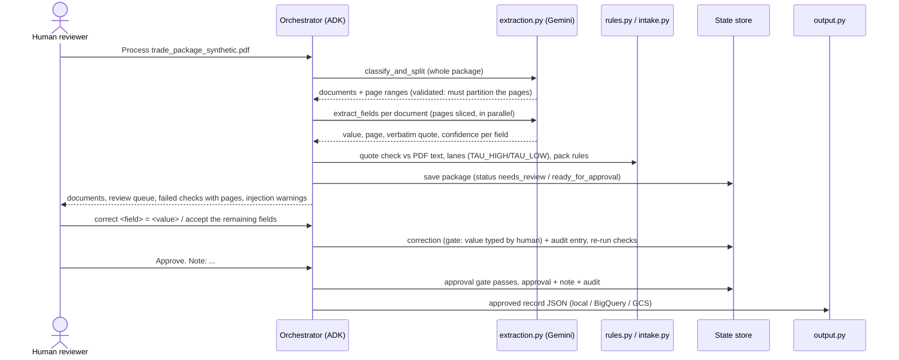

# Architecture

## Flow



Only two steps call a model (split, extract); lanes, checks, gates, audit and
output are deterministic code. The orchestrator LLM only routes and explains.

## Gates (in code, `callbacks.gate_tool_call`)

| Tool | Rule |
|---|---|
| `correct_field` | The value must appear in the human's latest message |
| `accept_fields` | The human's message must explicitly accept/confirm (no "you accept") |
| `approve_record` | Review queue empty; no split problems; approval in a **later turn** than the last change; message classified as explicit approval (not decline, not delegation like "approve it yourself"); a reviewer note (`Note: ...`) if any check failed — taken from the human's message, overriding whatever the model passed |
| `approve_record` (tool) | Refuses unless an approval is on record in the state store |

The gate trusts whoever types in the chat: production needs authenticated
reviewers and roles (e.g. four-eyes on high-severity failures).

## Lanes

`auto` (confidence ≥ TAU_HIGH), `review` (≥ TAU_LOW), `reject` (below, or a
required field is empty). Confidence is model-reported; if the cited quote is
not found in the PDF text of the cited page it is capped at 0.6 (review).
Pages without a text layer (scans, images) cannot be verified (`quote_verified:
null`).

## Record (`records/<package_id>.json`)

```
package_id, pack, source_file, advisory_notice,
documents[]: {index, doc_type, pages:[start,end],
              fields: {name: {value, extracted_value, page, quote, quote_verified, confidence, lane, status}}},
checks[]: {id, type, severity, status pass|fail|skipped, message, details, evidence[{ref, document_index, value, page}]},
injection_warnings[], review_notes[], approval {approved_by, approved_at, reviewer_note, human_message},
audit[]: {at, who, action extracted|corrected|accepted|approved, ...old/new values}
```

## State & resume

The package document (same shape plus status and lanes) is saved after every
step in the configured backend (`memory`, `local` JSON, `firestore`). With
`local` or `firestore`, a reviewer can stop and resume later: "Process
<file>" or "status" reloads the saved review state instead of re-extracting.

## Relation to the small business loan sample

[`contrib/python/small-business-loan-agent`](../../../../../contrib/python/small-business-loan-agent/)
(Nora Filali, AI FDE Financial Services) shows a full downstream loan
workflow: document extraction → underwriting → pricing → human approval →
loan decision, with Firestore repair & resume and an LLM judge. This skill
generalizes its **document-extraction stage** (and its sample PDFs) into a
pack-driven intake step; underwriting, pricing and decisions are
loan-specific downstream steps and are intentionally not part of this skill.
The human-approval gate, pluggable state, repair & resume and LLM judge
patterns are carried over. The trade-finance pack follows the FDE
trade-document pattern (split → per-type extraction → cross-document checks →
review queue) from Bradley Ramos's catalog; its sample is newly generated and
synthetic.

## Production path

Regional `GOOGLE_CLOUD_LOCATION`, Firestore state, `gs://` sources, BigQuery
output, authenticated reviewers, calibrated thresholds per field, and
optionally Document AI for high-volume, layout-stable forms
([document-ai.md](document-ai.md)).
