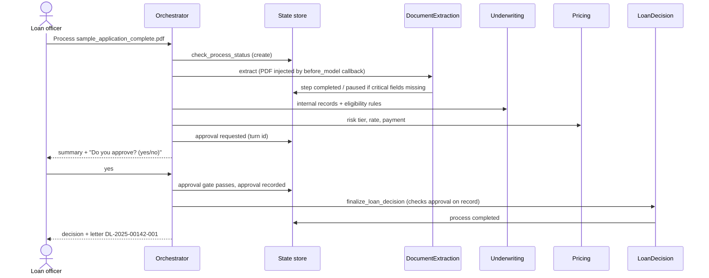

# Architecture

Adapted from [`contrib/python/small-business-loan-agent`](../../../../../contrib/python/small-business-loan-agent/)
(AI FDE Financial Services: Nora Filali, Neil Desai). The agent graph, prompts,
pydantic schemas, mock bank systems, LLM judge and repair & resume logic are
carried over; the changes are listed at the end.

## Flow



## Gates

| Gate | Where | Rule |
|---|---|---|
| Halt check | orchestrator `before_tool` | No sub-agent runs while the process is `pending_approval` (needs repair), `completed`, `declined` or `failed` |
| Step prerequisites | sub-agent `before_agent` | A step runs only when all earlier steps are `completed`/`approved` |
| Human approval | orchestrator `before_tool` on `LoanDecisionAgent` | Pricing done; summary shown in an **earlier** turn; latest human message classified as explicit approval (not "decline", not delegation such as "approve it yourself"); records approver + message + time |
| Approval on record | `finalize_loan_decision` | Refuses unless the state store holds `approval.decision == approved` (defense in depth) |
| Human repair | orchestrator `before_tool` on `repair_application_field` | The repaired value must appear in the human's message |
| LLM judge | orchestrator `after_agent` | Trajectory + grounding check; appends a "Quality check" warning when it fails |

The approval classification is deterministic (regex) and unit tested; it is
deliberately conservative: anything that is not a clear "yes / approve / I
approve" is treated as not approved. It does not authenticate the person
typing: production needs identity and role checks (e.g. only users with a
loan-officer role may approve, four-eyes for large amounts).

## State document

One document per `loan_request_id` (memory dict, JSON file, or Firestore
`process_states/<id>`):

```
overall_status: active | pending_approval | awaiting_human_approval | completed | declined | failed
current_step:   DocumentExtractionAgent | UnderwritingAgent | PricingAgent | LoanDecisionAgent | null
steps.<Agent>:  { status, data, completed_at, repairs[] }
issues[]:       { step, description, missing_fields[], resolved, resolved_by, ... }
approval:       { requested_at, requested_invocation_id, decision, decided_by, decided_at, human_message }
```

Repair options: in chat ("Repair SBL-2025-00391: loan_amount_requested =
$150,000"), or, as in the original sample, by editing the document
(`steps.DocumentExtractionAgent.data`, set its `status` to `completed` and
`overall_status` to `active`) in the Firestore console or the local JSON file,
then "Resume processing for SBL-2025-00391".

## Changes vs. the contrib sample

- Packaged as an Agent Plugins skill (`scripts/` package, `App(name="scripts")`,
  Q-MODE `SKILL.md`, `design-spec.md` → `setup.py` → `.env`).
- **State backends**: `memory` / `local` JSON / `firestore`, selected by
  `STATE_BACKEND`; Quick start needs no Firestore. Workflow logic moved into a
  backend-independent `StateStore` (dict in, dict out) so it is unit tested.
- **Enforced HITL**: approval gate + approval record + check in
  `finalize_loan_decision`; new `awaiting_human_approval` status so "resume"
  after pricing can no longer jump straight to the decision step (the original
  resume logic returned `LoanDecisionAgent` as the next step).
- **Repair in chat** via `repair_application_field` (human-typed values only),
  besides editing the state document.
- **Applications by file name**: `list_applications` / `select_application`,
  and sample file names or request IDs in the message are recognised, so
  `adk web` uploads are not needed. Sources: bundled, local folder, `gs://`.
- `reset_demo_application` (memory/local only) to rerun demos.
- `loan_purpose` is a plain string (Vertex AI rejects an empty enum value).
- Sub-agent prerequisite failures return a message instead of raising.
- LLM judge: prompt extended with the repair / refusal / status patterns;
  `LLM_JUDGE=off` switch; judge model defaults to `MODEL_NAME`.
- Agent Starter Pack / Agent Engine deployment targets, `GeminiPreview` model
  wrapper and the PDF generator were dropped (the contrib sample keeps them).

## Production path

Firestore state, `gs://` applications, a regional `GOOGLE_CLOUD_LOCATION`,
real internal-records and pricing services behind the tools, authenticated
approvers, and deployment to Agent Engine or Cloud Run (see the contrib
sample's `Makefile` for an Agent Engine path).
